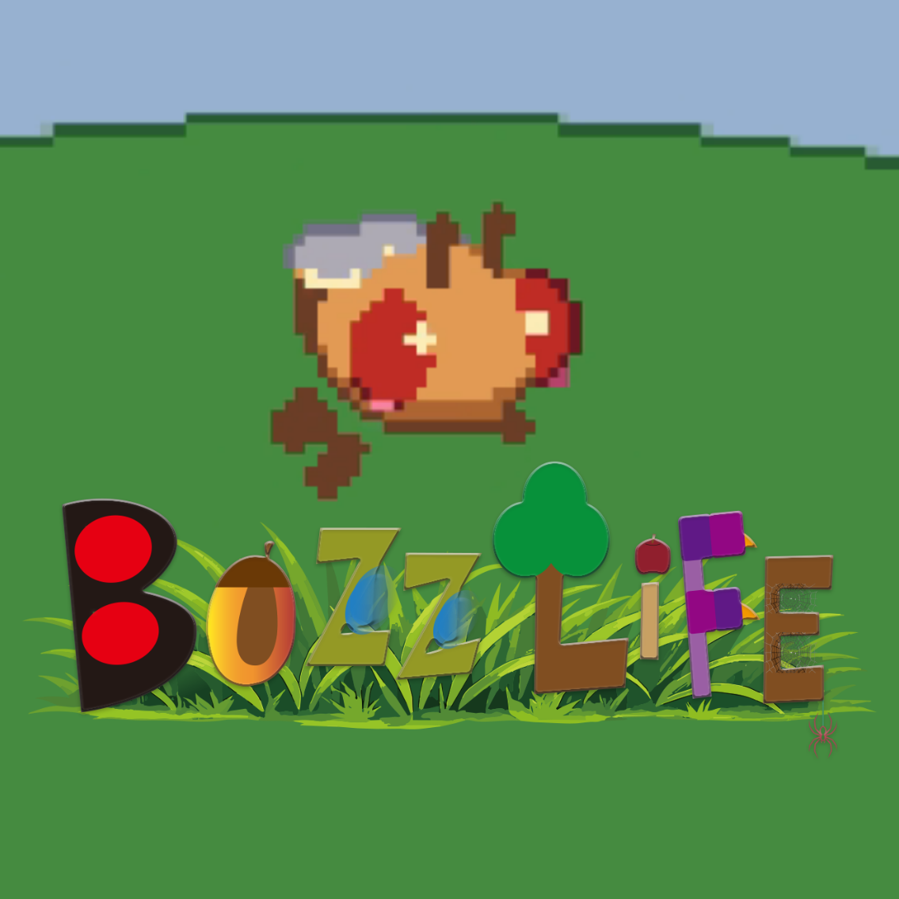
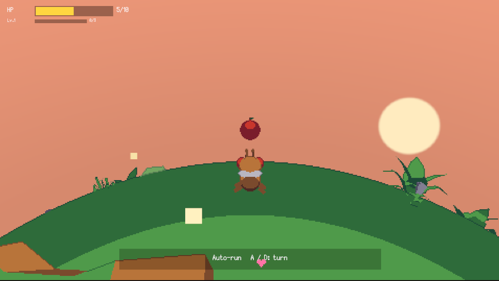
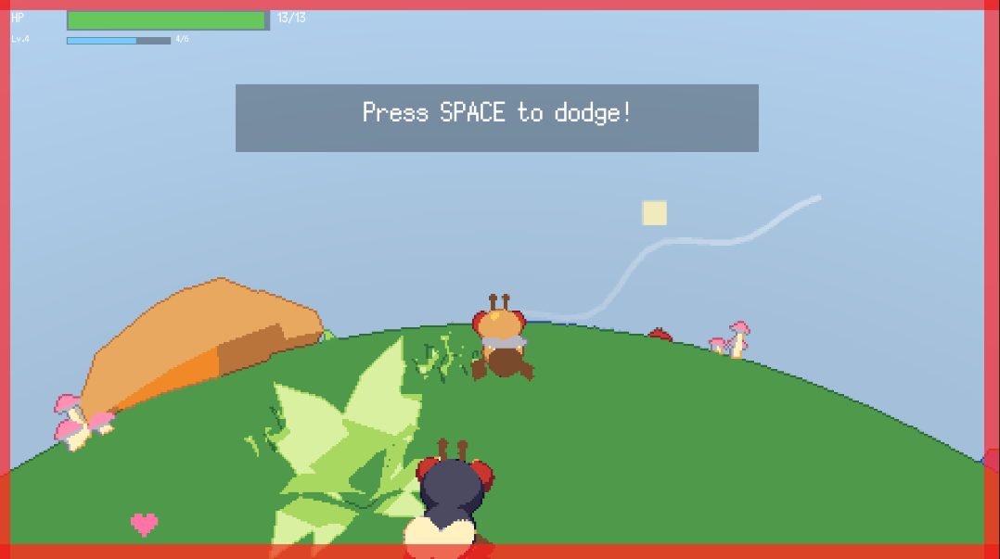
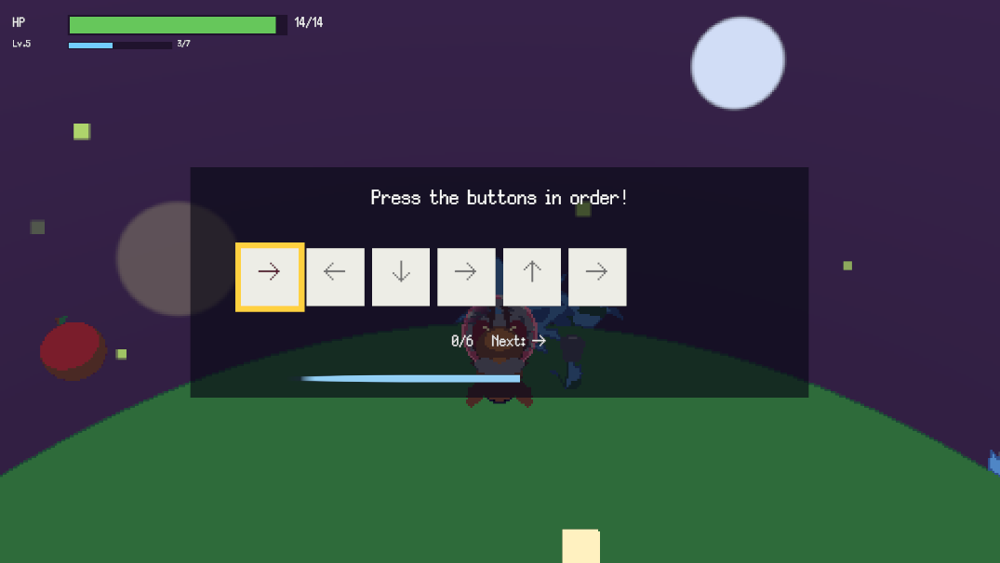
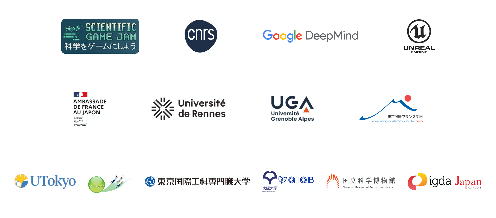

<h1 align="center">Buzz Life</h1>

    <i>~ from Buzz Studio (Scientific Game Jam Tokyo 2026 Team 3) ~</i>

Pitch: You're Baz 'The Fly' from now! Find your foods and mates to be alive! Walk away from your pursuers to save you longer!

How to play: a gamepad or a keyboard. Use direction pad (gamepad) or direction keys (keyboard) to move Baz laterally, or face button (A in Xbox gamepad) or SPACE (keyboard) to accelerate forward or dodge the enemies!

Visuals: 

Credits: Buzz Studio

- Kazuki Nishimura (Scientist)

- Masahiro Awamura (Programmer)

- Ji Hyo Jae (Planner)

- Chihaya Matsumura (Sound)

- Sora Horikawa (Planner)

- Hiara Yamamoto (Planner)

- Tatsunori Yamada (Planner)

- Hiroto Takisawa (Programmer)

AI used in this game:

・Gemini 4 Carbon

・Gemini 4 Neon

・Claude

・Codex

Free assets used in this game:

・NA

License: This game is licensed under Creative Commons CC-BY-NC 3.0.

Science behind Buzz Life: What is obstacle avoidance in walking fly? What could be the contents of its behavior? This game is inspired by those questions in the research of obstacle avoidance in walking fruitfly [1]. Fruitfly, or just 'fly' in this game, is a tiny animal that has incredible maneuvers to be alive its unforgiving nature, including enemies, foods, and mates. In this game, you struggle life as a fly. You can be in hard mode without avoiding obstacles. That can be why flies, or the terrestrial animals needed to develop an ability of estimating future path of its pray or its predator, in other words, prediction.

1: [Unpublished] PhD project of Kazuki Nishimura, Yanagihara Lab, UTokyo, Japan.

Text: Kazuki Nishimura

---

ゲーム説明：BuzzLifeではハエの成虫である「バズ」の一生を体験していただきます。羽化したばかりのバズは右も左も分からない新参者！天敵のトンボやハエトリグモ、恋のライバルである他のオスバエを避けて、恋人を見つけ出し、過酷な自然環境を生き残れ！
BuzzLifeは羽化したばかりのオスのショウジョウバエである「バズ」が、天敵や障害物を避けながら食べ物や恋人を探して奮闘する、３Dアクションゲームです。

操作方法：
1. バズ（ハエ）は一定速度で前進します。左右の移動は方向キーを使って行います。XboxコントローラーのAボタン、またはキーボードのSPACEキーで加速・回避モーションが行えます。

2. 追いかけてくるオスに追いつかれると喧嘩フェーズに入り、XboxコントローラーのAボタン、またはキーボードのSPACEキーの連打で喧嘩を制することができます。

3. メスに接触すると求愛フェーズに入り、コントローラーの指定されたボタンか方向キーの指定されたキーの組み合わせで求愛歌を成功させるとクリアです。

4. バズの体力は時間経過とともに減少していきます。食べ物に接触することで体力を回復することができます。

ビジュアル・トレーラー：

クレジット：Buzz Studio

・西村 和貴（サイエンティスト）

・粟村 昌弘（プログラマー）

・Ji Hyo Jae（プランナー）

・松村 千隼（サウンド）

・堀川 颯来（プランナー）

・山本 ヒアラ（プランナー）

・山田 龍儀（プランナー）

・滝沢 拓人（プログラマー）

使用された生成AI:

・Gemini 4 Carbon

・Gemini Neon

・Claude

・Codex

使用されたフリー素材:

・なし

著作権：本作はCreative Commons CC-BY-NC 3.0ライセンスの下で公開されています。本作は2026年11月20日から22日まで開催された、第3回Scientific Game Jam Tokyoで制作されました。本イベントの主催・共催・協力団体は下記の通りです。

ゲームの背後にある科学: 

1: (未発表) 博士論文、西村和貴、柳原研究室、東京大学、日本

文章：西村 和貴
